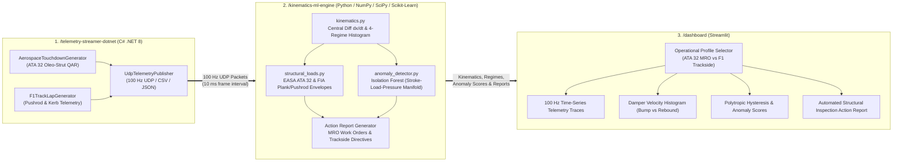

# DynaLoad-Telemetry — Implementation Plan

> [!IMPORTANT]
> **Mission Statement:** Build a unified 100 Hz ($\Delta t = 10\text{ ms}$) structural load, damper kinematics, and unsupervised anomaly detection platform supporting **Profile A: Aerospace MRO (ATA Chapter 32 Landing Gear)** and **Profile B: Motorsport Formula 1 Trackside (Suspension & Kerb Loads)**.

---

## 1. System Architecture & Data Flow

---

## 2. Shared Physical & Mathematical Formulation

Both an **aircraft landing gear oleo-pneumatic shock strut (ATA 32)** and a **Formula 1 pushrod-actuated hydropneumatic/coil-over damper** obey the non-linear quarter-mass hydro-pneumatic differential equation:

$$m_s \ddot{z}_s + F_{\text{gas}}(x, P_0, \gamma) + F_{\text{hyd}}(\dot{x}, c_{\text{LS}}, c_{\text{HS}}) + F_{\text{seal}}(\dot{x}) = F_{\text{ext}}(t)$$

### 2.1 Telemetry Frame Schema (100 Hz / $\Delta t = 10\text{ ms}$)

| Field | Type | Unit | Profile A (Aerospace ATA 32) | Profile B (Formula 1 Trackside) |
| :--- | :--- | :--- | :--- | :--- |
| `timestamp_ms` | `int64` | $\text{ms}$ | Monotonic QAR frame clock ($10\text{ ms}$ step) | Monotonic ECU ATLAS frame clock ($10\text{ ms}$ step) |
| `vertical_g` | `float64` | $\text{G}$ | CG vertical load factor $n_z$ ($0.8\text{--}3.2\,\text{G}$) | Chassis/pushrod vertical acceleration ($-0.5\text{--}6.0\,\text{G}$) |
| `roll_deg` | `float64` | $\text{deg}$ | Bank angle at touchdown ($-8^\circ\text{ to }+8^\circ$) | Chassis roll angle in cornering ($-2.5^\circ\text{ to }+2.5^\circ$) |
| `pitch_deg` | `float64` | $\text{deg}$ | Flare attitude to nose-down derotation ($-1^\circ\text{ to }+12^\circ$) | Braking dive / aero squat pitch angle ($-1.8^\circ\text{ to }+1.5^\circ$) |
| `strut_stroke_mm` | `float64` | $\text{mm}$ | Main gear oleo compression ($0\text{--}450\text{ mm}$) | Damper potentiometer travel ($0\text{--}65\text{ mm}$) |
| `internal_pressure_bar` | `float64` | $\text{bar}$ | Oleo $N_2$/hydraulic chamber pressure ($28\text{--}230\text{ bar}$) | Damper $N_2$ reservoir pressure ($10\text{--}62\text{ bar}$) |
| `wheel_speed_kph` | `float64` | $\text{km/h}$ | Tire spin-up at Weight-on-Wheels ($0\text{--}265\text{ kph}$) | Wheel speed sensor ($85\text{--}340\text{ kph}$) |

### 2.2 Numerical Differentiation & 4-Regime Velocity Classification

Given discrete stroke measurements $x[n] = \text{strut\_stroke\_mm}[n]$ sampled at $f_s = 100\text{ Hz}$ ($\Delta t = 0.01\text{ s}$), damper velocity $v[n] = \dot{x}[n]$ ($\text{mm/s}$) is computed via second-order central differences in the interior and second-order one-sided differences at boundaries:

$$v[n] = \frac{x[n+1] - x[n-1]}{2\,\Delta t}, \quad n \in [1, N-2]$$

Velocity regimes are classified around a profile-specific blow-off knee velocity $v_{\text{knee}}$:
- **High-Speed Bump (HSB):** $v > +v_{\text{knee}}$ (touchdown sink impact / sawtooth kerb strike)
- **Low-Speed Bump (LSB):** $+v_{\text{deadband}} < v \le +v_{\text{knee}}$ (quasi-static pitch/roll/heave compression)
- **Static / Deadband:** $|v| \le v_{\text{deadband}}$
- **Low-Speed Rebound (LSR):** $-v_{\text{knee}} \le v < -v_{\text{deadband}}$ (controlled chassis/airframe recovery)
- **High-Speed Rebound (HSR):** $v < -v_{\text{knee}}$ (rapid wheel unloading / recoil bounce)

### 2.3 Polytropic Gas Spring & Isolation Forest Manifold

Internal chamber pressure $P(x)$ follows the polytropic compression law:

$$P_{\text{expected}}(x) = P_0 \left( \frac{L_0}{L_0 - \min(x, 0.96\,L_0)} \right)^\gamma$$

The **Isolation Forest** model is trained on nominal 6D physics-informed feature vectors:

$$\mathbf{f}_n = \left[ x_n,\; v_n,\; P_n,\; a_{z,n},\; \frac{P_n}{P_{\text{expected}}(x_n)},\; \frac{|v_n|}{|a_{z,n}| + 0.1} \right]$$

This detects:
1. **Nitrogen ($N_2$) Gas Pre-Charge Loss / Seal Blow-By:** Sub-nominal pressure ratio $P_n / P_{\text{expected}}(x_n) \ll 1.0$ accompanied by excessive stroke excursion $x_n$ for a moderate vertical load $a_{z,n}$.
2. **Hydraulic Damping Degradation (Cavitation / Oil Leakage / Shim Fatigue):** Unbounded damper velocity spikes $|v_n|$ relative to vertical load $a_{z,n}$ and under-damped ringing oscillations.

---

## 3. Repository Module Breakdown

### Module 1: `/telemetry-streamer-dotnet` (C# .NET 8 Console App)
- `DynaLoad.TelemetryStreamer.csproj`: .NET 8 console project (`net8.0` with `<RollForward>LatestMajor</RollForward>`).
- `Models/TelemetryPacket.cs`: Immutable telemetry frame record with `timestamp_ms`, `vertical_g`, `roll_deg`, `pitch_deg`, `strut_stroke_mm`, `internal_pressure_bar`, `wheel_speed_kph`, profile/scenario metadata, plus JSON and CSV serializers.
- `Simulation/AerospaceTouchdownGenerator.cs`: Generates 100 Hz ATA Chapter 32 QAR touchdown sequences across three scenarios:
  - `nominal`: Smooth $1.42\,\text{G}$ touchdown, $285\text{ mm}$ stroke, intact $30 \to 128\text{ bar}$ polytropic compression.
  - `overload`: Severe $2.78\,\text{G}$ high-sink-rate crabbed hard landing ($5.8^\circ$ roll), $438\text{ mm}$ stroke bottoming, triggering EASA AMM 05-51-11 Phase 2 inspection.
  - `fault`: $N_2$ gas charge leak ($18\text{ bar}$ pre-charge) + hydraulic orifice metering valve wear causing excessive stroke ($415\text{ mm}$) and post-impact bounce under a moderate $1.68\,\text{G}$ landing.
- `Simulation/F1TrackLapGenerator.cs`: Generates 100 Hz F1 suspension telemetry across a multi-sector micro-lap (main straight aero load, heavy braking zone, high-speed chicane kerb strike, fast sweeper):
  - `nominal`: Peak $3.1\,\text{G}$ cornering/aero load, $48\text{ mm}$ max stroke, balanced bump/rebound histogram.
  - `overload`: Aggressive sausage-kerb strike ($5.4\,\text{G}$ vertical spike, $+820\text{ mm/s}$ high-speed bump velocity) and high-speed aero bottoming ($63.5\text{ mm}$ stroke, plank strike).
  - `fault`: Damper nitrogen bladder pressure loss ($8.5\text{ bar}$) and hydraulic cavitation causing severe high-speed oscillation and loss of platform control.
- `Networking/UdpTelemetryPublisher.cs`: Streams packets at 100 Hz ($10\text{ ms}$ period) via UDP socket (`127.0.0.1:5005` by default) and supports deterministic CSV/JSON export for offline analysis and CI verification.
- `Program.cs`: Full CLI interface (`--profile`, `--scenario`, `--duration-sec`, `--host`, `--port`, `--export-csv`, `--fast`).

### Module 2: `/kinematics-ml-engine` (Python, NumPy, SciPy, Scikit-Learn, Pytest)
- `kinematics_ml_engine/models.py`: Typed dataclasses (`ProfileConfig`, `TelemetryBatch`, `KinematicsResult`, `OverloadEvaluation`, `AnomalyResult`, `InspectionReport`) and preset configurations for `AEROSPACE_ATA32_CONFIG` and `F1_TRACKSIDE_CONFIG`.
- `kinematics_ml_engine/kinematics.py`:
  - `compute_damper_velocity()`: 100 Hz numerical derivative ($dx/dt$ in $\text{mm/s}$) with optional Savitzky-Golay smoothing for noisy potentiometer channels.
  - `classify_velocity_regimes()`: Categorizes each sample into `HIGH_SPEED_BUMP`, `LOW_SPEED_BUMP`, `STATIC`, `LOW_SPEED_REBOUND`, `HIGH_SPEED_REBOUND`.
  - `compute_velocity_histogram()`: Computes binned bump vs. rebound distributions, regime occupancy percentages, bump-to-rebound symmetry ratio, peak velocities, and kerb-strike / bottoming event counts.
- `kinematics_ml_engine/structural_loads.py`:
  - Evaluates peak vertical G-load envelopes, coupled roll/pitch overload conditions, stroke utilization percentage, and EASA ATA 32 / FIA Trackside structural triggers.
  - Synthesizes a structured `InspectionReport` with severity level (`NOMINAL`, `ADVISORY`, `MANDATORY_INSPECTION`, `CRITICAL_GROUNDING_OR_PARC_FERME`), triggered rule codes, and actionable maintenance/engineering tasks.
- `kinematics_ml_engine/anomaly_detector.py`:
  - Physics-informed feature engineering (`expected_polytropic_pressure`, pressure residual ratio, damping admittance $|\dot{x}|/|a_z|$).
  - `StrutAnomalyDetector`: Wraps `sklearn.ensemble.IsolationForest` (with a built-in deterministic NumPy/SciPy `IsolationForest` implementation fallback for air-gapped environments) to score stroke-vs-load-vs-pressure signatures and diagnose specific fault modes (`GAS_PRESSURE_LOSS`, `HYDRAULIC_DAMPING_DEGRADATION`, `MECHANICAL_BOTTOMING_OVERLOAD`).
- `kinematics_ml_engine/simulator.py` & `kinematics_ml_engine/udp_listener.py`:
  - Python 100 Hz synthetic telemetry generator (matching the C# streamer's differential equations) and non-blocking UDP telemetry receiver.
- `tests/`: Comprehensive Pytest suite (`test_kinematics.py`, `test_structural_loads.py`, `test_anomaly_detector.py`, `test_end_to_end.py`).

### Module 3: `/dashboard` (Streamlit)
- `dashboard/app.py`:
  - Mode selector switching dynamically between **"Aerospace MRO Mode (ATA 32 Landing Gear)"** and **"Formula 1 Trackside Mode (Suspension & Kerb Loads)"**.
  - Scenario selector (`Nominal Run`, `Overload / Hard Landing / Kerb Strike`, `Hydraulic & Gas Pressure Fault`, or `Live UDP / CSV Import`) + interactive physics perturbation sliders.
  - Multi-panel 100 Hz telemetry waveforms, Bump vs. Rebound Damper Velocity Histogram, Polytropic Stroke-vs-Pressure Hysteresis & Isolation Forest Anomaly Manifold, and an automated **Structural Inspection Action Report** panel.

### Module 4: CI/CD & Documentation
- `.github/workflows/tests.yml`: Automated GitHub Actions workflow running `pytest` on `/kinematics-ml-engine` and `dotnet build` + smoke execution on `/telemetry-streamer-dotnet`.
- `README.md`: Engineering-grade technical documentation detailing the unified dynamical systems mathematics, physical equivalence between ATA 32 landing gear struts and F1 suspension dampers, system architecture, and operational guides.
